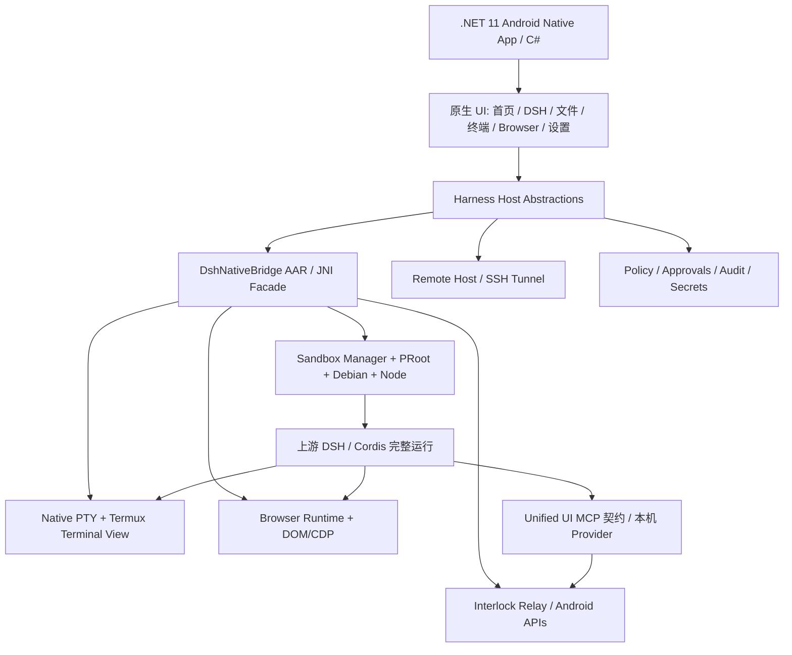

# DSH Mobile：基于 DSHBox 与 .NET 11 for Android 的完整架构与实施方案

> 方案版本：V1.0  |  编制基线：2026-11-09  |  项目定位：实用型 Android DeepSeek Harness 客户端  
> 性质：技术方案与分阶段实施计划；**不是已经构建完成的 APK**。版本、兼容性和性能结论均须在真实设备上验收。

---

## 0. 执行摘要与不可妥协的决策

**目标**：以 [WSK-build/DSHBox](https://github.com/WSK-build/DSHBox) 为工程基础，以 `.NET 11 for Android` + C# 为新 App 的主要宿主和业务开发语言，原样运行上游 [DeepSeek Harness](https://github.com/deepseek-ai/deepseek-harness)，提供完整的 DSH 核心功能、Cordis 插件、Linux 运行环境、终端、文件、浏览器自动化、手机原生能力、MCP 与远程连接；专注生产力、开发和自动化，不内置桌宠、娱乐游戏、养成、装饰性系统。

**六项不可妥协原则**：

1. **不重写 DSH Agent 内核**：Node.js/TypeScript/Cordis 原样运行，.NET 只承担 Android Shell、控制面与系统集成。
2. **以 DSHBox 为底，不整仓翻译**：保留其可复用 Kotlin/Java/Native 运行时作为 AAR/Native 组件，再以 C# 逐步替换 App UI 与编排；保留上游来源与补丁记录。
3. **完整功能 = 上游完整 + Android 兼容矩阵**：不能把“WebView 能打开”视为“全功能可用”；按 `web/headless/sdk/sdk-minimal/acp/plugin`、终端、文件、子代理、工具、审批、附件逐项验收。Android 受限功能允许明确的受限状态或受控降级，禁止假报支持。
4. **Core + Optional Features**：核心默认仅含 DSH、运行时、会话、终端、文件、基本插件；Browser / Mobile Automation / Remote / Developer Tools 等按功能启用，不做娱乐功能。
5. **一套 UI 自动化能力**：复用既有 [maiji1990/ui_mcp](https://github.com/maiji1990/ui_mcp) 的 `ui_*` 契约，将手机本机 AccessibilityService 作为新 Provider，不能并行做一套互相冲突的 DSHBox Pilot / dsh-Go / ADB 自动化接口。
6. **许可证可追溯**：如果复用 DSHBox GPL-3.0 源码或派生 AAR，整个发行方案按对应 GPL 义务设计，并保留独立组件的原许可；必须更换 DSHBox 的专有名称和品牌图形。

**建议 V1 设备边界**：Android 10+（API 29），ARM64 优先，Android 14/16/17 作为主测试目标；x86_64 模拟器用于开发，不保证所有原生运行层从第一版就可用。虽然 .NET 11 Android 可低至 API 24，DSHBox 与 Interlock Relay Core 的现有边界为 API 29，不能直接据此承诺 Android 8/9。

---

## 1. 官方 .NET 11 现实约束（非常重要）

截至 2026-11-09，.NET 11 的最新确认版本为 **11.0.0 RC3（2026-10-25）**；计划于 **2026-11-10** 正式发布。该版本为 STS。新仓库可从 `net11.0-android` 启动，SDK 和 workload 都应锁版本，并在 GA 后做独立升级 PR。

- **Android 默认 CoreCLR**：.NET 11 Android 默认使用 CoreCLR；**不要**套用 .NET 10 及以前的 Mono AOT 设置。
- **不设置 `UseMonoRuntime=true`**：会被 .NET 11 SDK 拒绝；不要设置旧 `RunAOTCompilation` / `AotAssemblies` 用来“开启 AOT”。
- **初始以 CoreCLR/ReadyToRun 为基线**：先通过 JNI/AAR、WebView、终端和 Android 17 真机测试，再单独评估 NativeAOT。`PublishAot=true` 不是首版必需品。
- **ADB / JDK / Gradle 是构建依赖，不是应用内 Node 依赖**：.NET 进程与 Debian/Node 运行在不同执行环境中。
- **绑定形式**：Kotlin/Java 组件由 Gradle 构建为 AAR；使用 `.NET for Android` 的 `android-bindinglib` 与 `<AndroidLibrary ... />` 包装。绑定成功不代表其 Kotlin 协程、Compose 和传递依赖已自动工作，必须做完整打包与真机验证。

官方参考：
- [.NET 11 RC3](https://github.com/dotnet/core/blob/main/release-notes/11.0/preview/rc3/11.0.0-rc.3.md)
- [.NET for Android Build Properties](https://learn.microsoft.com/dotnet/android/building-apps/build-properties)
- [Binding a Java Library](https://learn.microsoft.com/dotnet/android/binding-libs/binding-java-libs/binding-java-library)
- [.NET for Android Build Items](https://learn.microsoft.com/dotnet/android/building-apps/build-items)

### 1.1 选择 `.NET for Android`，而不是首版 MAUI

首版只针对 Android、重度使用前台 Service / Accessibility / Shizuku / WebView / PTY / JNI，因此用 **原生 .NET for Android Activity、Fragment、View/AndroidX** 比引入完整 MAUI Shell 的风险小。共享的领域层全部写成 `net11.0` 类库。未来若做 Windows/iOS，可以增加前端宿主而不挪动 DSH 协议层。**不得在首版引入 MAUI + Blazor Hybrid + Kotlin Compose 三套 UI 堆栈。**

---

## 2. DSHBox 复用审计：保留、抽取、重建

| DSHBox 模块（已核对仓库） | 当前职责 | DSH Mobile 策略 | 注意事项 |
|---|---|---|---|
| `sandbox-manager` | Debian/Node/DSH 分层、PRoot 生命周期、校验与升级 | **优先保留，做 AAR Facade** | 依赖 `common`、zstd JNI 等，需要迁入 runtime native libs |
| `common` | 版本、常量、网络源、日志等 | 保留原 Kotlin 依赖，逐步建立 C# 对应模型 | 不复制两套事实源 |
| `terminal-session` | 多终端会话、PRoot shell 调度 | 保留原生会话核心 + .NET 适配 | PTY 输出用流或 FD，不能每字符 JSON |
| `terminal-view` / `terminal-emulator` | Termux 终端内核 | 保留 Android View，供 C# 宿主嵌入 | Apache-2.0 及第三方声明 |
| `plugin-manager` | Cordis 插件管理、市场、修复模式 | 复用**后端**，Compose 页面用 C# 重建 | Gradle 模块当前含 Compose UI，需拆分服务/UI |
| `pilot/interlock-relay-core` | 39 项手机能力、审批、审计、信箱 | 优先复用 Apache-2.0 独立核心 | 仅供本机 Provider，不复制另一套 UI MCP |
| `pilot/dshbox-adapter` | DSHBox 专有 UI/权限接线 | **重写为 DshMobileAdapter** | 避免带入品牌和 App 资源 |
| `pilot/developer-access` | ADB、Root 开发者通道 | Optional Developer Tools | 与普通 Agent 工具完全隔离 |
| `browser/browser-api` | 浏览器契约 | 复用或通过薄协议适配 | Web DOM 工具与 Android A11y 分开 |
| `browser/browser-runtime` | 浏览器 WebView 会话 | 复用可封装部分 | 主线先系统 WebView；Gecko 按兼容验证后再引入 |
| `browser/browser-bridge` | Browser 沙箱工具调用 | 适配到 Cordis / MCP | 严格鉴权/来源限制 |
| `browser/browser-devtools` | DOM、CDP、Network/HAR 诊断 | Optional | 调试能力必须独立授权 |
| `dsh-renderer` | System WebView/Gecko 适配 | 保留兼容知识，C# 重建宿主接口 | 不在 C# 中重新实现 DSH 前端 |
| `app` | 全部 UI、导航、设置和前台服务 | **主要重建为 .NET App** | 原 App 包名/图标/商标不可直接沿用 |
| `bridge` | WebView Bridge 安全框架 | 审计后选择性复用 | 不暴露任意 Native JavaScript 调用 |

**迁移顺序不是文件夹顺序**：先把可以作为“服务”运行的代码与 DSHBox Compose UI、Activity、`R.*` 资源引用分开，编译为最小 AAR；后迁终端 View 与浏览器；最后迁插件管理页面。对有深度 UI 依赖的模块宁可重做 C# 外层，不强制把全部 Kotlin 方法绑定进 C#。

### 2.1 版本与上游同步策略

- 建立你自己的 GitHub 仓库，并从 DSHBox 选定的**固定 commit SHA / release tag** 制作 `upstream/dshbox` 引用。不要追随浮动 `main`。
- 推荐 `third_party/dshbox/` 做**带来源、许可证、patch 登记的 Git Subtree/受控 Vendor 快照**；也可用独立 fork + submodule，但 CI 必须固定 SHA。
- 采用 `docs/UPSTREAMS.md` 记录原 commit、模块许可证、修改理由、上游差异、定期同步记录。
- **不要把源项目原始目录结构写入客户端业务代码**；Gradle 通过适配层输出稳定 AAR，C# 只识别 `DshNativeBridge` 的稳定 API。
- 所有 Fork 修改用独立补丁和分支保存；自动对比代码、资源、许可证、CI 产物，人工审查再升级。

---

## 3. 最终总体架构



**三类边界**：

1. **C# 控制面**：Activity/Navigation、Runtime/Host 状态、安装更新、设置、插件管理、文件列表、权限 UI、日志、异常、云端/远程配置。
2. **Android Native 服务面**：Kotlin/Java 的 PRoot/PTY、AccessibilityService、Shizuku、WebView、前台服务、通知、文件选择、原生传感器/日历/媒体；以 AAR 提供窄的公共 API。
3. **Node Harness 执行面**：DSH、Cordis、工具、插件、终端命令、工作区、会话历史和模型；通过 loopback RPC、文件信箱和原有 Web UI 与控制面通讯。

### 3.1 禁止出现的错误架构

- 由 C# 自己维护另一个 Agent Loop；使原生 UI 变成“缩水版 DSH”。
- 由 C# 直接访问 DSH 私有 JSONL/SQLite 并假定 schema 不变，绕过官方 Session API。
- 把 PRoot 虚拟 root 视为硬安全隔离；用户安装的插件和容器内命令仍需视为有风险。
- 在 Android 上同时运行两套 AccessibilityService，分别提供 `phone_*` 和 `ui_*` 操作而没有锁、授权和统一审计。
- 把高级调试的完整 ADB/Root 授权当成普通手机控制的默认权限。

---

## 4. “完整 DeepSeek Harness 功能”的明确验收范围

### 4.1 引擎能力矩阵

| 功能 | 实现方式 | V1 判断标准 |
|---|---|---|
| DSH 启动与停止 | 官方 CLI + Host Manager | 可启动/停止/重启，异常后可诊断 |
| `web` profile | 官方 DSH WebUI | 全量 UI 和模型对话可使用 |
| `headless` profile | 原 CLI | 后台无头任务能启动并得到 exit/result |
| `sdk` profile | 原 CLI + SDK JSON-RPC | 真实握手、事件、取消与调用通过 |
| `sdk-minimal` profile | 原 CLI | 真实启动并独立测试 |
| `acp` profile | 原 CLI / ACP Server | 真实协议握手、会话控制通过 |
| `plugin` 命令 | DSH 官方插件管理 | 可装、卸、禁用、校验与回滚 |
| Cordis profile / bundle / patch | 保留官方目录结构与包 | `--dump-config`、profile 切换通过 |
| Model Providers / 凭据 | 官方模型适配器 + 安全存储 | 配置、切换、错误提示通过 |
| Session / Resume / Fork | 官方协议 | 历史恢复/分叉，无数据损失 |
| 工具调用与审批 | DSH 原能力 + Host 原生审批 | 等待、允许、拒绝、取消均可恢复 |
| Subagent / Agent Team | 官方 Cordis 实现 | 子代理建立、取消、消息与工具状态正确 |
| Bash / PTY / 子进程 | Debian + Node / Native PTY | 命令输出、CTRL、SIGINT、会话恢复 |
| 文件、工作目录、附件 | guest/host 文件桥 + SAF | 图片/文本/二进制/上传下载正常 |
| MCP / Skills / 自定义工具 | DSH 官方与独立移动插件 | 完整注册、授权、错误/超时准确 |
| 更新与诊断 | 层更新与 Runtime log | 可回滚、保留用户数据 |

**边界声明**：上游 Harness 本身处于 developer preview，存在兼容性破坏。即使通过 V1 测试，也不能承诺所有桌面专用能力（Electron window、Docker 容器、PC GUI、Chrome 桌面 CDP、非 ARM64 原生扩展）在 Android 上天然可用。遇到受限 API 明确 `unavailable/degraded`，不要静默降级或伪装“成功”。

### 4.2 核心应用功能

- **首页**：运行环境、DSH 状态、一键启动/重启/关闭、CPU/内存/磁盘（标识估值或实测）、诊断、更新、安全提示。
- **DSH 工作区**：系统 WebView 承载原版 WebUI、自动鉴权、恢复会话、文件选择、分享/下载、键盘与视口兼容；原生导航不覆盖 DSH 页面。
- **文件管理**：guest 工作区、App 私有区、用户已授权 SAF 树、下载与共享区；搜索、复制、移动、压缩/解压、预览、外部分享、路径保护。
- **终端**：真正 PTY、多 session、CTRL/ESC/TAB/方向键、复制粘贴、进程生命周期、文本编码、横屏适配。
- **插件管理**：官方 Cordis 源、插件市场（来源可配）、依赖完整性、安装前提示、加载日志、安全模式恢复；新增插件仍由 DSH 的包管理器管理。
- **设置**：模型、引擎、Runtime 版本、联网代理、网络、数据迁移、权限、MCP、隐私、开发者模式、日志。

### 4.3 实用型功能分层：Core + Optional

| 模块 | 默认 | 定位 |
|---|---|---|
| `core.harness` | 开 | DSH 核心与 WebUI |
| `core.runtime` | 开 | PRoot/Debian/Node/DSH 层管理 |
| `core.terminal` | 开 | 多终端 |
| `core.files` | 开 | 文件访问与工作区 |
| `core.plugins` | 开 | 插件管理与恢复 |
| `optional.browser` | 关，可安装/启用 | Browser 24 工具 / DOM/CDP |
| `optional.mobile-automation` | 关，按权限开 | 手机语义树/点击/文本/截图/虚拟屏 |
| `optional.remote-host` | 关，用户配置 | SSH、远程 DSH、跨设备工作 |
| `optional.developer` | 关，高风险 | 完整 ADB / Root / 调试 |
| `optional.workflow` | 不作为 V1 必选 | 工作流和计划任务（使用上游能力/插件为先） |
| `optional.gecko-renderer` | 按包选择 | 系统 WebView 不兼容时的替代方案 |
| `entertainment.*` | **不提供** | 桌宠、小游戏、养成、无关动画与无关社交 |

“Optional”不代表每个插件必须单独 APK；初期可用**能力开关 + 延迟装配 + 可见权限声明**，资源真正独立交付以后再做模块动态下载。

---

## 5. 原生 Android UI 策略（C# 优先）

**UI 技术决策**：`MainActivity + Fragment/AndroidX + Material 设计规范 + C# ViewModel/State`。主导航 5 项：首页、DSH、文件、终端、浏览器。插件与设置归首页二级菜单；窄屏 Browser 可配置隐藏标签。页面不放宠物、壁纸商店、动画勋章等装饰项。

- **原生 C# 页面**：首页、Runtime 管理、Settings、Files、Plugin Manager、Device Permission、Logs。
- **保留系统 WebView**：DSH 完整 WebUI。用 Host 适配触摸、键盘、文件上传/下载；无须从零复刻 DSH 全部组件。
- **终端原生 Java View**：通过封装 `TermuxTerminalView` 挂载在 C# 宿主 ViewGroup，底层 PTY 在原生服务；优先复用现有经过测试的渲染。
- **浏览器原生 WebView**：与 DSH WebUI 使用**不同会话、权限、cookie/store 和调用契约**；禁止跨 origin 随意注入调试桥。
- **深色/浅色 + 多窗口/横屏/平板**：使用 Android 原生 window insets，不把 Gecko 处理补丁误用到系统 WebView。
- **无障碍**：所有原生 C# 控件提供 contentDescription/label/focus/touch target；不是只要求 Agent 读取别人页面，自己页面也必须可访问。

### 5.1 原生聊天的取舍

V1 **不从头写第二套聊天 UI**；使用官方 DSH WebUI，确保上游新工具、新插件 UI、模型设置与系统提问不丢失。V2 可另做原生 C# 聊天作为“用户可选视图”，但必须通过官方 SDK/Web RPC 而非读取内部数据库。任何原生视图缺少的功能直接回到 WebUI；二者共享同一会话 ID、工具状态与权限审批。

---

## 6. .NET ↔ Kotlin / Java / Native 桥接设计

### 6.1 Facade 策略（减少 Java Binding 问题）

新建独立 Gradle Library `native-bridge`，只暴露**普通 Java 可见接口**，内部调用 DSHBox Kotlin 管理器；复杂 Kotlin `suspend`/Flow/Compose 类型不能直接作为 .NET 公共 API。

```java
public final class DshNativeFacade {
    public void initialize(android.content.Context context);
    public void execute(String requestJson, NativeCallback callback);
    public void subscribe(NativeCallback callback);
    public void close();
}

public interface NativeCallback {
    void onEvent(String json);
}
```

`execute` 是示例控制面 API，**不得**用于高频画面、pty 大量输出和大文件；高吞吐数据应使用文件描述符/PFD、原生 stream、单独 socket 或原 Android View。实际工程可将请求拆成类型安全的 `RuntimeApi`、`TerminalApi`、`BrowserApi`、`RelayApi`，外部保持兼容 facade。

**建议可调用契约 v1**：

```json
{
  "protocol": 1,
  "requestId": "uuid",
  "method": "runtime.start",
  "deadlineMs": 30000,
  "payload": {"profile": "web"}
}
```

响应：

```json
{
  "protocol": 1,
  "requestId": "uuid",
  "ok": true,
  "code": "OK",
  "payload": {"state": "RUNNING", "endpoint": "http://127.0.0.1:3080"}
}
```

安全契约：`requestId` 幂等、超时/取消 token、错误码稳定、单写者、所有回调关联生命周期；`endpoint` 只供内部展示与连接，不意味着无鉴权即可访问。UI 不能阻塞主线程等待 Bridge。

### 6.2 .NET 绑定项目示例（示意，需要按真实 SDK 测试）

```xml
<Project Sdk="Microsoft.NET.Sdk">
  <PropertyGroup>
    <TargetFramework>net11.0-android</TargetFramework>
    <IsBindingProject>true</IsBindingProject>
    <Nullable>enable</Nullable>
  </PropertyGroup>
  <ItemGroup>
    <AndroidLibrary Include="../../artifacts/native/dsh-native-bridge-release.aar" />
  </ItemGroup>
</Project>
```

使用 `dotnet new android-bindinglib` 创建实际模板后调整项目文件。对只需随包分发、不需要 C# 包装的第三方 AAR 设置 `Bind="false"`；必须检查其 transitive AAR / POM / Proguard 依赖。不要一次性对整个 DSHBox 工程生成数万类型的 C# 绑定。

### 6.3 宿主服务的 Android 生命周期

- `Application`：装配 DI、日志、Keystore、运行环境状态；不能在 Application 初始化时自动申请 Root。
- `MainActivity`：展示和控制；关闭页面不等于杀掉 Harness。
- `HarnessForegroundService`：长期运行必须是合法 foreground service type，Android 13+ 通知授权、Android 14+ 后台启动/服务类型限制逐项核对。
- `AccessibilityService`：**独立系统服务**；仅用户手动开启，停止能力不等于自动撤销系统授权，关闭配置必须立即停止处理新操作。
- `BootReceiver`：仅在用户明确开启且系统允许的情形下恢复**被允许恢复的任务**，不偷偷启动 root/相机/麦克风。
- `RuntimeWatchdog`：监测宿主/PRoot/Node/DSH 存活、端口、健康和异常退出；恢复需有限重试和人工终止能力。

---

## 7. Debian + Node + DSH 运行环境

### 7.1 层级与写入策略

```text
app-private/
  runtime/
    base/<version>/          # Debian 13 arm64（只读语义）
    node/<version>/          # Node 24 等完整兼容层
    dsh/<version>/           # 官方发布 DSH npm 包
    android-side/<version>/  # PRoot / Loader / native .so
    manifests/               # 签名清单、sha256、兼容约束
    current.json             # 原子切换指针
    rollback/                # 旧 manifest 与旧可回滚层
  user-data/
    dsh-home/                # DSH_HOME；用户凭据/配置分隔保护
    projects/
    plugins/                 # 保持官方 pnpm/DSH 管理位置
    downloads/
  logs/
  artifacts/
```

V1 可参照 DSHBox 在 APK 内置 DSH + android-side、base/node 首次按网络镜像安装或离线导入。禁止每次 App 更新重置 `user-data`。运行层不是 C# .NET runtime，它是**另一个 Debian/glibc + Node** 环境。

### 7.2 生命周期状态机

`NOT_INSTALLED -> DOWNLOADING -> VERIFYING -> EXTRACTING -> READY -> STARTING -> RUNNING -> STOPPING -> STOPPED`。

异常状态 `CORRUPT / UPDATE_FAILED / START_FAILED / CRASH_LOOP / OUT_OF_SPACE / PERMISSION_BLOCKED`；每个状态都具有恢复动作和真实日志。层更新用临时目录校验，再原子切换 manifest；故障回滚时禁止覆盖新的用户资料。

### 7.3 Layer Manifest 与供应链

```json
{
  "schema": 1,
  "target": "android-arm64",
  "components": [
    {"id": "base", "version": "debian13-r1", "sha256": "<real-sha256>", "source": "<trusted-url>"},
    {"id": "node", "version": "24.x", "sha256": "<real-sha256>", "source": "<trusted-url>"},
    {"id": "dsh", "version": "<pinned-official-version>", "sha256": "<real-sha256>", "source": "<trusted-url>"},
    {"id": "android-side", "version": "<pinned-build>", "sha256": "<real-sha256>", "source": "<trusted-url>"}
  ],
  "signature": "<signed-manifest-proof>"
}
```

上述是**协议示例占位符，绝不能作为真实下载清单使用**。SHA-256 只能检测数据与清单是否一致；清单和 APK 本身仍需要可信发布者签名、公钥钉住或安全更新通道。下载应支持断点续传、临时存储空间预检、签名校验、无损失败回滚。

### 7.4 原生扩展兼容

- `node-pty` 等 `.node` 模块必须与 ARM64、Node ABI、Debian glibc 和目标设备内核环境匹配，且由可追溯的构建工件供应；不能把 Android bionic `.so` 直接当 Debian glibc `.so`。
- 镜像层带原生 ABI manifest；`dsh doctor` 检查 Node 版本、glibc、pnpm、PTY 与官方 CLI。
- 插件包含不支持 ARM64、依赖桌面 Electron/Docker/Chrome 的原生组件时，安装前提示实际兼容结果，失败不破坏 DSH 核心。
- PRoot 提供用户态兼容层而不是容器级安全隔离或真实 root；数据访问取决于 Android App UID、挂载、SAF 和授权。

---

## 8. DSH 对接：保持完整上游与兼容性

官方 DSH 架构不是一个不可分割的大 Web Server：其 `web`、`headless`、`sdk`、`sdk-minimal`、`acp` profiles 分别对应不同使用方式，Cordis Profile/Bundle/Patch 组成插件树。

**要求**：

1. 以**官方包版本**为 source of truth，单独维护 `dsh-version.lock`，记录 npm 包版本、SHA 和兼容矩阵。
2. App 的 `mobile-host`/`mobile-mcp` 仅通过 Cordis 插件扩展工具、宿主信息、Android 能力；不 patch Agent Loop、会话落盘及核心模型适配器。
3. 采用 DSH 自有插件安装、profile patch/CLI 作为配置入口；程序 UI 不私自改掉插件注册格式。
4. 对外 SDK/ACP 的实际可用性由真实 RPC / ACP 握手验收；不能只检查进程起来。
5. UI 侧 WebView 做 auth token 更新、导航代次、401 恢复、下载、文件选择、外链、键盘、底栏适配；**不要**改动 DSH 网页代码或依赖脆弱 DOM query 维持主功能。
6. 将升级错误划分为 `runtime`、`bridge`、`dsh profile`、`plugin`、`renderer`、`session`，各自的日志、回滚方式独立。

### 8.1 最小真实验证命令

```bash
node --version
pnpm --version
dsh --version
dsh --profile web --dump-config
dsh web --no-open
# 以下在兼容测试中分别启动并由对应客户端握手：
dsh headless
dsh sdk
dsh sdk-minimal
dsh acp
dsh plugin --help
```

上述是**命令入口示意/核对清单**：每条准确参数与退出约定以锁定版本的 `dsh --help` 为准。`headless` 等 profile 可能需要额外任务/环境参数；不能单靠这里的无参数命令判定功能通过。

### 8.2 插件的双层设计

- **DSH 插件**：Cordis 内运行的业务和 Agent 工具，由 Node 管理器装配并维护。
- **Android 能力包**：.NET / AAR 宿主实现，只有对应 Cordis 插件声明的窄 API 能访问；不开启则不暴露工具。

例如 `dsh-mobile-host` Cordis 插件只注册 `device_status`, `file_pick`, `ui_snapshot`, `ui_click` 等模型工具，但真正授权和执行受 .NET Policy + Relay Core 双重约束。用户可卸载/禁用功能适配插件，而不影响 DSH WebUI 核心。

---

## 9. 手机自动化 + 既有 `ui_mcp` 的复用方案

你已有的 `maiji1990/ui_mcp` 仓库已经面向 `net11.0`，实现统一 `ui_*` 契约、Windows FlaUI、Android ADB Provider、作用域 element ref、单写者锁、审批/审计、动作后重快照；Android 本机门面仍是需要接通的方向。

**不新建一个平行的 Mobile MCP**：

```text
DeepSeek Harness / Cordis mobile plugin
              │
              ▼
    ui_* Unified UI Contract  ← 现有 ui_mcp（共享 DTO、错误码、策略测试）
              │
       OnDeviceAndroidProvider（新增）
              │
       Interlock Relay / AccessibilityService
              ├── Semantic tree / find / click / text
              ├── Screen screenshot fallback
              ├── Shizuku / ADB / privileged operations [optional]
              └── VirtualDisplayProvider [optional]
```

### 9.1 与既有 ui_mcp 的契约共用

- 保留 `ui_list_devices` / `ui_snapshot` / `ui_find` / `ui_click` / `ui_set_text` 等既有公开方法。
- `deviceId` 区分 `android-local`、`android-adb:<serial>`、`windows:<host>`。
- `snapshotId + refId` 只在当次快照和设备会话有效；旧引用返回 `STALE_ELEMENT`，**不偷偷退到旧坐标**。
- 同一设备所有写入必须由统一设备租约/单写者调度，即便同时存在 Pilot、手势注入和 adb 也不能竞态执行。
- `UIA`/无障碍树优先，屏幕截图仅在语义不可得时兜底；Canvas、受保护窗口以及输入框结构空缺时按事实声明。
- 操作后重新快照验证：成功返回不等于实际完成。

### 9.2 `Interlock Relay` 对应位置

它是**Android 执行层 / 审批拦截层**，不是对外统一 MCP Server。`ui_mcp` 在上面统一语义、Snapshot、Ref、跨 Windows/Android 兼容性；两层不重复定义审批等级。

- 复用 Relay Core 已有权限/审计/信箱能力，但用 `RelayPolicyAdapter` 对接统一 R0–R4 等级，保证**最终执行由同一 Policy Decision 决定**。
- 对于 dshbox `mobile-pilot` 工具：V1 可做短期兼容别名，但不向模型同时暴露两套含义相近的工具，避免模型反复调用和重复审批。
- Browser 的 DOM / CDP 元素引用使用单独 `browser_*` namespace，不把移动无障碍树和 DOM 混成同一种结构而丢掉 frame/selector 语义。

### 9.3 虚拟屏设计

- V1 作为可选实验功能；创建/复用/停止/预览必须使用同一个 display session registry。
- 一次操作绑定明确 `displayId`；禁止因为目标虚拟屏丢失而默认把点击落到真实屏幕。
- 虚拟屏具有独立应用生命周期、用户可见的状态及一键终止；用户操作物理屏幕不能默默切换 Agent 目标屏。
- 虚拟屏“有画面”**不代表**同一屏上的无障碍节点树一定完整；需显式标记 `semanticAvailable` / `pixelOnly`。

---

## 10. Browser 自动化设计

复用 DSHBox 的 Browser 能力，但保持**浏览器会话管理与 Android 手机操控分离**。网页场景优先 DOM/Accessibility Tree/CDP 结构，而不是每步截图坐标。

### 10.1 Browser 对外工具类别

- 标签页/会话：创建、关闭、切换、导航、等待；
- 结构化读取：DOM snapshot、元素定位、可见文本、表单信息、iframe 与 shadow-root 范围；
- 操作：点击、输入、滚动、选择、上传前审批；
- 诊断：screenshot、console、network/HAR（明确授权）、脚本执行（高风险）；
- 用户接管：暂停 AI，允许用户在同一浏览器页面处理登录/验证码，然后返回状态。

**权限限制**：网页无法默认调用 Android 任意 API；CDP/任意 JS evaluate/请求重放必须高风险单独审批；账号 Cookie、OAuth token 等原始数据不得写入常规日志和模型上下文。

### 10.2 System WebView vs Gecko

V1 先做 System WebView（Android 内核供应可控且减少 APK），为 GeckoView 预留 `IRenderer`。Gecko 需要额外 AAR、导航/弹窗/文件上传/权限/worker 一整套测试。**不要一开始双内核同步开发**；当兼容矩阵达到门槛，再发布独立 Gecko 变体，与 System 变体共享 Data/Layout 和签名。切换 APK 必须验证同包名同签名和用户数据无损。

---

## 11. 远程 DSH（建议作为差异化模块）

虽然 DSHBox 侧重本机，但新项目可以提供 **Local Host 与 Remote Host 统一抽象**：

```csharp
public interface IHarnessHost
{
    string HostId { get; }
    Task<HostCapabilities> GetCapabilitiesAsync(CancellationToken ct);
    Task<HostState> StartAsync(string profile, CancellationToken ct);
    Task StopAsync(CancellationToken ct);
    Task<Uri?> GetWebEndpointAsync(CancellationToken ct);
    IAsyncEnumerable<HostEvent> WatchEventsAsync(CancellationToken ct);
}
```

- `LocalHarnessHost`：.NET → JNI/AAR → PRoot Node/DSH；允许本机手机操控。
- `SshHarnessHost`：用户 SSH 密钥 + 显式 Host Key 校验 + 本地端口转发；只使用远端实际提供的 Web/SDK/ACP 能力。
- 远程 DSH 不应被默认授予手机本机 AccessibilityService；需要独立 Device Gateway 授权并保留审计。
- 对远端与本机的 capability 缺失/受限明确显示，不试图伪装相同。
- 避免自己实现不安全的远程代码执行 HTTP Server；V1 只支持受信 SSH/TLS，凭据用 Android Keystore 加密保护。

---

## 12. 安全、权限、隐私与合规

### 12.1 威胁模型

主要风险：不可信 DSH 插件、网页提示注入、手机敏感 UI 误操作、第三方 WebView 跳转、远程主机恶意响应、Root/ADB 过度授权、更新工件被替换、终端命令误删、日志泄露、共享存储路径逃逸。

### 12.2 设计控制

| 边界 | 必须控制 |
|---|---|
| DSH WebUI | `127.0.0.1` loopback only、有效会话 token、origin 校验、旧 token 失效、绝不导出到公网 |
| JS Bridge | URL allowlist、主 frame/来源校验、功能白名单、方法级鉴权；不要提供任意 shell 接口 |
| Shell | 默认不包含 Root/ADB 管理员执行；开发者通道独立开关、明确风险并提供关闭检查 |
| Android UI | 应用白/黑名单、敏感操作审批、密码/支付默认人工处理、操作后核验 |
| Storage | SAF 持久授权而非广泛读所有文件默认打开；路径 canonical、反符号链接、大小/速率限制 |
| 更新 | TLS + signed manifest + artifact hash + 原子切换 + 旧版本回退 |
| Secrets | Android Keystore + 加密存储；分享、备份和诊断包默认排除 key/token/SSH 私钥 |
| Browser | 跨域隔离、下载/上传前审批、DOM 与 CDP 高风险功能分档 |
| Plugins | 源、版本、依赖、许可证清单；第三方插件具有容器内代码执行风险，不能仅依赖 Token 鉴权宣称隔离 |
| Audit | 同步记录 `actor/host/tool/action/outcome/approval/target`，日志不保留密码/屏幕完整内容 |
| Remote | 首次连接主机指纹确认、SSH 密钥保护、最小权限、显式转发配置 |

**Root 与 ADB**：开发者通道不经过 Pilot 的正常动作级限制是 DSHBox 既有方案的特性，但新项目不能因此让 Agent 获得默认特权；建议开发者工具与 Agent 工具权限完全分隔，默认仅供用户手工交互，若要授权 Agent 必须二次显式声明、一次性会话授权和命令级确认。

### 12.3 GPL 与商标路线

- **推荐发行路线 A**：Fork DSHBox 的 GPL-3.0 源码并保留相关许可证、NOTICE、源码提供义务；新写的整体衍生 App 按兼容 GPL 许可分发。明确检查各个第三方组件特殊条款。
- **独立 Apache-2.0 组件**：如 `interlock-relay-core`，保留自己的许可证和署名；它本身不能“洗掉”从 DSHBox GPL 部分复制来的代码。
- **路线 B（不推荐首版）**：若以后追求非 GPL 的商业封闭产品，则需要干净实现与严格法律评估，不能在改写 C# 后认为 DSHBox 原有 GPL 自动消失。
- **品牌限制**：更换 APP 名称、图标、Splash、品牌标识；不要沿用 DSHBox 官方标识或暗示其背书。也要避免将“DeepSeek 官方客户端”作为描述。
- 本节是工程合规规划，正式发布前需要按源代码依赖和发行方式审核许可证，不构成法律意见。

---

## 13. 建议仓库结构（动态上游，不写死第三方内部细节）

```text
dsh-mobile/
├─ DshMobile.slnx
├─ global.json                         # SDK 锁版本
├─ Directory.Build.props
├─ src/
│  ├─ DshMobile.Android/               # net11.0-android, MainActivity/Service/UI
│  ├─ DshMobile.Core/                  # net11.0, DTO + Interface
│  ├─ DshMobile.Application/           # net11.0, use cases / state
│  ├─ DshMobile.Harness/               # DSH host, profiles and RPC
│  ├─ DshMobile.Runtime/               # layer manifests, updates, diagnostics
│  ├─ DshMobile.NativeBinding/         # AAR Java binding
│  ├─ DshMobile.Terminal/              # PTY session facade + native view adapter
│  ├─ DshMobile.Storage/               # files + SAF + workspace
│  ├─ DshMobile.Plugins/               # Cordis plugin manager UI facade
│  ├─ DshMobile.Browser/               # browser / renderer abstraction
│  ├─ DshMobile.Automation/            # `ui_mcp` contract provider
│  ├─ DshMobile.Remote/                # SSH / remote host
│  └─ DshMobile.Security/              # policy, credentials, audit
├─ native/
│  ├─ native-bridge/                   # Gradle AAR / minimal Java public facade
│  ├─ dshmobile-adapter/               # 新 App/Relay 宿主接线
│  └─ build-native.sh
├─ plugins/
│  ├─ dsh-mobile-host/                 # Cordis plugin, Android runtime facts
│  ├─ dsh-mobile-mcp/                  # ui_* tools registration
│  └─ dsh-browser-tools/               # browser_* registration
├─ third_party/
│  ├─ dshbox/                          # fixed fork/subtree: only needed reusable modules
│  └─ ui_mcp/                          # existing project as reference/submodule/package
├─ runtime-bundle/                     # manifest/build tooling, no untracked binary in git
├─ tests/
│  ├─ Unit/
│  ├─ Contract/
│  ├─ Android.Instrumentation/
│  ├─ Harness.Integration/
│  └─ E2E/
├─ tooling/
│  ├─ doctor/
│  ├─ sync-upstreams/
│  ├─ verify-licenses/
│  ├─ verify-artifacts/
│  └─ package/
├─ docs/
│  ├─ ARCHITECTURE.md
│  ├─ FEATURES.md
│  ├─ PROVIDER_CONTRACTS.md
│  ├─ SECURITY.md
│  ├─ UPSTREAMS.md
│  ├─ COMPATIBILITY.md
│  ├─ TEST_PLAN.md
│  ├─ ADR/
│  └─ milestones/
└─ .github/workflows/
   ├─ android-dotnet.yml
   ├─ native-aar.yml
   ├─ contract.yml
   └─ release.yml
```

目录是新项目的**建议稳定边界**，而不是断言 DSHBox 上游所有文件现在都可直接搬进该目录。同步脚本通过上游 manifest 识别来源和包版本，不能通过字符串硬编码扫描上游内部文件路径以作运行时依赖。

### 13.1 App `.csproj` 初始样例

```xml
<Project Sdk="Microsoft.NET.Sdk">
  <PropertyGroup>
    <OutputType>Exe</OutputType>
    <TargetFramework>net11.0-android</TargetFramework>
    <SupportedOSPlatformVersion>29</SupportedOSPlatformVersion>
    <ApplicationId>org.example.dshmobile</ApplicationId>
    <ApplicationTitle>DSH Mobile</ApplicationTitle>
    <Nullable>enable</Nullable>
    <ImplicitUsings>enable</ImplicitUsings>
    <LangVersion>14.0</LangVersion>
    <RuntimeIdentifiers>android-arm64;android-x64</RuntimeIdentifiers>
    <AndroidPackageFormats>apk</AndroidPackageFormats>
    <PublishAot>false</PublishAot>
  </PropertyGroup>
  <ItemGroup>
    <ProjectReference Include="../DshMobile.Core/DshMobile.Core.csproj" />
    <ProjectReference Include="../DshMobile.NativeBinding/DshMobile.NativeBinding.csproj" />
  </ItemGroup>
</Project>
```

注意：`ApplicationId` 只是占位值；Android target SDK/compile SDK、Keystore、manifest、proguard、`PackageReference` 依赖应在初始工程生成后以实际 workload 与工具链核对，不建议现在凭经验填入未经验证的属性。`PublishAot=false` 只是明确首版策略，不是对 NativeAOT 永久否定。

### 13.2 环境命令

```bash
# 当前 RC3 建立实验工程；正式版发布后更新 global.json 并重新做基线
# 全新机器先安装对应版本 .NET SDK 与 Android SDK/JDK
dotnet workload install android
dotnet new android -n DshMobile.Android
# 按模板设置 TargetFramework=net11.0-android 等属性

dotnet build src/DshMobile.Android/DshMobile.Android.csproj -f net11.0-android -c Debug
```

V1 同时安装 JDK、Android SDK command-line tools、platform tools、必要 NDK、Gradle wrapper。`dotnet new android` 与 SDK 可用版本在 CI 里做真实 smoke test；如果模板未随所装 SDK 带来，先使用官方 `android` 模板包，不编造项目结构。

---

## 14. 分阶段开发路线（每阶段都有可验收产物）

### M0 — 许可/基线/仓库

- [ ] 在自己的组织/仓库下创建 `dsh-mobile`，准备全新品牌资源。
- [ ] 锁 DSHBox fixed SHA、DSH official fixed version、.NET 11 RC3/GA、Relay SHA、SDK/NDK/JDK/Node。
- [ ] 列出 DSHBox 模块与 App 依赖树、GPL/Apache/MPL/LGPL 及品牌资产清单。
- [ ] 在源 Android DSHBox 工程中完整构建一个可用 APK 作为对照基线；记录冷启/热启/首装耗时、内存、磁盘、稳定性。
- **验收**：DSHBox 基线真机运行、来源及许可证可复现；不修改上游业务逻辑。

### M1 — .NET 11 Android 空壳 + Native Bridge POC

- [ ] 新建 .NET for Android App、C# 原生首页、按钮、诊断日志。
- [ ] Gradle 构建最小 Java Facade AAR，.NET binding 项目可成功调用 `getVersion()` / callback。
- [ ] 连续切后台、旋转、恢复、进程结束测试。
- **验收**：在 Android 10 与 Android 16/17（至少一台）真机，C# -> JNI -> Kotlin -> C# 回调 1000 次稳定、无明显内存泄漏。

### M2 — Runtime Manager 复用与运行 DSH

- [ ] 将 Sandbox Manager 封装成窄 API，带资产签名/校验、层安装、启动/停止和错误状态。
- [ ] Android foreground service 可维持 Node/DSH 运行，App UI 暂离后可恢复。
- [ ] 宿主 `dsh --version`、`dsh web`、健康探测、带 Token 的 WebUI 连通。
- **验收**：首次安装、重复启动、Stop、Force stop 恢复、磁盘不足、层缺失、更新失败，均能给出明确状态；无孤儿 PRoot 进程。

### M3 — Harness 全功能基线与 WebView

- [ ] 完整 WebUI、session、tools、approval、attachment、profile、subagent、插件等无回归。
- [ ] `web/headless/sdk/sdk-minimal/acp/plugin` 分别做真正握手/任务测试。
- [ ] 构建版本化 Harness compatibility report；上游 DSH 更新作为单独合并请求。
- **验收**：`FEATURES.md` 矩阵达到 V1 标准；发现桌面专用能力时显示限制原因。

### M4 — 文件 + 终端 + 插件管理 C# UI

- [ ] 终端多 PTY session、快捷键/复制粘贴/控制信号。
- [ ] guest ↔ SAF 文件列表、导入导出、并发文件流和路径安全。
- [ ] Cordis 插件安装/卸载/修复模式、兼容检查和加载日志。
- **验收**：大文件传输、并发会话、含原生模块插件失败、断网更新等回归通过。

### M5 — Mobile MCP 与 Android 原生能力

- [ ] `interlock-relay-core` 从 DSHBox 中独立编译并经 Adapter 接到 .NET 策略与 UI。
- [ ] 复用 `ui_mcp` 模型，新增本机 Provider：语义树、find/click/set_text、screenshot、状态与错误。
- [ ] 统一 R0–R4 审批、单写者和动作后再次快照验证。
- [ ] 可选 Shizuku/ADB、虚拟屏独立门控与资源回收。
- **验收**：Android 10/14/17 多窗口、横竖屏、锁屏、受保护页面、意外强杀、撤销无障碍授权等场景不越权。

### M6 — Browser 模块

- [ ] 引入 Browser API/Runtime/Bridge/Devtools，按权限与用户空间隔离。
- [ ] Browser 工具实测 DOM/read/click/input/wait/screenshot/upload/console/HAR。
- [ ] Gecko 变体依据兼容结果单独评估，不阻塞 System WebView 首版。
- **验收**：普通 SPA、重定向/登录、iframe、附件、断网、提示注入和权限撤销符合真实结果。

### M7 — Remote Host + Optional Feature 可用性

- [ ] SSH Host Key 校验、profile 连接、端口转发、远端状态和恢复。
- [ ] Local/Remote Host capability UI，一键断开；远程不能直接控制本机手机。
- [ ] 功能开关动态控制插件装配/能力显示与权限说明。
- **验收**：本机与远端切换不串会话、不泄漏 Token、网络断连可恢复。

### M8 — Release/升级/隐私/稳定性

- [ ] 双层更新兼容性、增量/离线/回滚、自动签名校验；发布 APK 和 Release Checksum。
- [ ] SBOM、许可校验、密钥扫描、APK 签名、Proguard/JNI 裁剪测试。
- [ ] 真实设备性能基线与持续运行/恢复测试；写用户文档、风险说明。
- **验收**：可复现构建、升级不丢对话/插件/工作区、禁止携带 DSHBox 品牌资源，并有完整可重复的安装说明。

**里程碑顺序可以调整，但 M1（C#/AAR 真机 POC）和 M2（真实 DSH 启动）必须先于漂亮 UI。不要在这两关通过前重写五个页面。**

---

## 15. 质量门禁与测试矩阵

### 15.1 测试设备建议

| 类别 | 设备/系统 | 作用 |
|---|---|---|
| 最低 API | Android 10 / ARM64 | 确认与 DSHBox/Relay minSdk 29 一致 |
| 主流 | Android 14 / ARM64 | 通知、后台、权限和现代服务限制 |
| 新版 | Android 16 / ARM64 | WebView、SAF、运行时回归 |
| 前沿 | Android 17 / ARM64 | 新权限/内核/反射/兼容限制 |
| 开发 | Android x86_64 emulator | .NET UI / JNI/权限冒烟；不强求所有 arm64 rootfs 运行 |
| 高限制 ROM | 小米/荣耀等厂商定制 | 后台限制、WebView、Shizuku/无线调试、无障碍恢复 |

### 15.2 关键验收用例

- **运行时**：清洁安装、重复安装层、损坏清单、磁盘不足、下载被中断、签名错误、层回退、旧用户数据保留。
- **DSH**：启动五种 profile、工具调用、流式响应、中断/重试、Session 恢复和分叉、附件、子代理与插件 reload。
- **UI**：冷启、热启、WebUI 401、token 轮换、弹键盘、横竖屏/多窗口、外链、上传/下载。
- **终端**：4 个并行 PTY、CTRL+C、中文/emoji、宽字符、滚动、应用切后台后恢复、大量输出。
- **自动化**：快照引用过期、敏感页面、审批拒绝、访问撤销、双写竞争、虚拟屏结束、不允许无障碍回退到真实屏坐标。
- **Browser**：跨域、iframe、SPAs、下载、Cookie 隔离、脚本执行审批。
- **安全**：不可信 Cordis 插件、Web 注入、恶意文件名、路径符号链接、远端 SSH 主机指纹更改、日志敏感信息扫描。
- **更新**：APK 更替后旧 DSH home 保留；运行层替换后插件与配置可复原；发布版本签名一致。

### 15.3 量化门槛（项目初始目标，需首个基线验证）

- `Crash-free` 实机冒烟门槛 ≥99%（规定测试运行集合，不等于线上稳定率）。
- 后台停止/恢复测试 100 次，不产生孤儿 PRoot 子进程。
- 1000 次 JNI Facade 调用，最终挂起回调为 0。
- 不允许 `ui_*` 旧 elementRef 在页面改变后被执行（零容忍）。
- 更新/回滚测试不丢会话、用户项目、已安装插件记录（零容忍）。
- 生产 APK 不应包含 debug bridge、明文 Token、测试密钥或其他 App 的受保护品牌资产（零容忍）。
- 性能目标应**先以 DSHBox 和 .NET 壳真机基线**测内存/启动/耗电，再定量，而不是凭空承诺某个绝对数值。

---

## 16. 构建 CI/CD 规划

**Native CI**：Temurin JDK、Android SDK/NDK、Gradle Wrapper；编译 `native-bridge`、Relay Adapter、Browser/Terminal 依赖，产出带 SHA 的 `.aar` 与 mapping 文件。

**.NET CI**：固定 .NET 11 SDK + `android` workload 版本；恢复 NuGet 和 AAR，编译 `net11.0-android` 和 `net11.0` 测试，运行 .NET Analyzer、静态审计。

**Harness CI**：固定 Node/pnpm 与官方 DSH tarball，测试 `dsh --version`、profile 配置、内置插件注册、兼容协议、许可证来源。

**Release CI**：Android Manifest、签名密钥、target SDK/ABI、runtime assets hash、应用名/商标资源扫描、许可证汇总、SBOM、APK 签名、可复现包名、GitHub Releases 附 SHA256SUMS + signed manifest。

**执行顺序**：native-aar → .NET-binding → app → emulator smoke → 真机 matrix（可自托管）→ release artifact。以 `Gradle` 和 `dotnet` 两套锁文件管理，不能在发布环节无约束使用 `latest`。

---

## 17. 主要工程风险与缓解

| 风险 | 严重性 | 缓解措施 |
|---|---|---|
| DSHBox Kotlin Compose 与 App 耦合，AAR 难剥离 | 高 | 先抽象 Facade/Service，保留纯 Native View，不整仓 Binding |
| .NET 11 CoreCLR Android 早期 bug / 设备差异 | 高 | 固定 SDK+workload，真机矩阵；首版不追 NativeAOT |
| DSH 开发预览破坏 API / schema | 高 | 固定 DSH 版本，完整 profile/插件矩阵、单独升级 PR |
| PRoot / Node 原生 ABI 不匹配 | 高 | 分层预编译、ABI manifest、真机 smoke、恢复模式 |
| 高权限 ADB/Root 造成安全破坏 | 高 | 独立 Developer Mode，默认禁 Agent 使用，命令级授权 |
| 多个手机控制 API 造成竞态 | 高 | 沿用 `ui_mcp` 单写者模型，唯一 Provider/设备租约 |
| 含 GPL 组件重新发行或使用商标 | 高 | 新品牌、完整 NOTICE/SBOM、合规审查 |
| 系统 WebView 不支持 DSH Worker/API | 中高 | document-start 能力探测、明确报错、Gecko 独立发布变体 |
| Binder/JSON 传输 PTY/截图性能差 | 中 | 控制平面 JSON，数据平面 FD/stream/shared artifact |
| 外部 DSH 连接授权 / TLS 混乱 | 中 | SSH Host Key pin、token 隔离、明确本机/远端模型 |
| 应用改版后数据兼容问题 | 中 | 只通过 DSH 官方协议维护会话，备份+迁移测试 |

---

## 18. 推荐给 Codex / AI Agent 的实施约束

在根目录 `AGENTS.md` 中明确：

1. 首先阅读 `docs/ARCHITECTURE.md`、`docs/UPSTREAMS.md`、`docs/SECURITY.md`、`docs/FEATURES.md`。
2. 未经审核不得修改 upstream DSH AgentLoop、Session Log、Cordis core。能力通过插件/官方 profile 扩展。
3. 原生 C# UI 不许绑定 DSHBox Compose 页面；先确保 Kotlin facade 所有跨语言 API 正常。
4. 每次变更：先实现最小垂直切片，再写单元/契约/Android Instrumentation 测试，CI 通过再增功能。
5. 禁止复制 DSHBox Logo、品牌名、商标资产；保留源码许可证和第三方署名。
6. 不能为了“看似支持”返回伪造的工具成功结果；系统限制必须稳定错误码并在 UI 可见。
7. `ui_*` / Mobile MCP 必须沿用既有契约与安全单写者规则；不重复造两个相同工具。
8. 第三方仓库路径由 upstream manifest/构建输出提供，不允许生产代码硬编码 fork 内部目录。
9. 重大变更先写 ADR；上游升级先做兼容性对照和变更日志。
10. Android 17 / 厂商 ROM 不能仅凭单元测试宣称通过，必须附真机证据。

### Codex 执行任务包（按顺序）

| Task | 任务名 | 主要产出 | 完成门槛 |
|---|---|---|---|
| `TASK-000` | 仓库初始化与许可证清单 | Repo、ADR、UPSTREAMS、AGENTS | 源可追溯 |
| `TASK-001` | DSHBox 原生基线测试 | Baseline report、APK manifest | 真机可运行 |
| `TASK-002` | .NET 11 Android POC | `DshMobile.Android`、SDK lock | 真机 C# 空壳可运行 |
| `TASK-003` | AAR / JNI bridge POC | Native Facade、binding、契约测试 | C# ↔ Kotlin 双向通过 |
| `TASK-004` | Runtime layer manager | 安装/启停/诊断状态机 | DSH 进程可控 |
| `TASK-005` | DSH 全 profile 接入 | Web / headless / SDK / ACP matrix | 真握手通过 |
| `TASK-006` | C# WebUI + auth adapter | DSH 工作区 | 真实会话可恢复 |
| `TASK-007` | C# Files + SAF | 文件操作界面 | 安全读写/导入 |
| `TASK-008` | PTY Terminal | 多终端 View | 控制信号正确 |
| `TASK-009` | Cordis Plugin Manager | 插件 UI、安全模式 | 插件安装/恢复通过 |
| `TASK-010` | Native Mobile MCP Provider | `ui_*` 本机执行 | 单写者/过期引用测试通过 |
| `TASK-011` | Browser automation | Browser + DOM/CDP | 关键 24 工具对照通过 |
| `TASK-012` | Remote Host | SSH Host + capability | 远程会话隔离 |
| `TASK-013` | Release hardening | SBOM、签名、回滚、真机报告 | Release Checklist 全通过 |

**AI 的第一张任务卡建议**：只执行 `TASK-000 ~ TASK-003`。不用先写五个页面或框架泛化。第一个可验证纵切片应当是“点击 C# 原生按钮 → JNI Native Bridge → Kotlin Sandbox Manager → 返回 DSH 版本/状态并展示日志”，之后才扩大到完整运行时。

---

## 19. 发布判定（Definition of Done）

只有同时满足以下条件，才称为“完成的 V1 实用型客户端”：

- [ ] **官方 DSH 未重新实现 Agent 内核**，可以在本机稳定运行和按版本升级。
- [ ] 经过端到端验证的 `web/headless/sdk/sdk-minimal/acp/plugin` 入口，公开不兼容矩阵。
- [ ] 基本 WebUI、终端、文件、插件、权限、更新/恢复与诊断可用。
- [ ] 手机自动化只通过统一 `ui_mcp` 契约；语义优先、单写者、审批和错误闭环。
- [ ] Browser 是可选模块；DOM/CDP 高危操作有审批与审计。
- [ ] 远程 Host（可选）不会意外获得本机敏感权限。
- [ ] Android 10/14/16/17 的至少覆盖矩阵有真实测试报告和明确缺口。
- [ ] GPL/第三方组件/商标处理到位，发布签名正确，用户数据升级不丢失。
- [ ] 所有功能均服务于开发、自动化和生产力，娱乐内容没有被打包进 Core。

---

## 20. 直接引用的官方与项目资料

1. DeepSeek Harness 官方源码与架构：<https://github.com/deepseek-ai/deepseek-harness>、<https://github.com/deepseek-ai/deepseek-harness/blob/master/docs/architecture.md>。
2. DSHBox 项目与结构：<https://github.com/WSK-build/DSHBox>、<https://github.com/WSK-build/DSHBox/blob/main/README.md>、<https://github.com/WSK-build/DSHBox/blob/main/TRADEMARK.md>。
3. Interlock Relay Core：<https://github.com/WSK-build/interlock-relay>、<https://github.com/WSK-build/DSHBox/blob/main/pilot/interlock-relay-core/README.zh-CN.md>。
4. 自有统一 UI MCP：<https://github.com/maiji1990/ui_mcp>（如为私有仓库，仓库外不能公开引用其细节）。
5. .NET 11 RC3 发布信息：<https://github.com/dotnet/core/blob/main/release-notes/11.0/preview/rc3/11.0.0-rc.3.md>。
6. .NET Android CoreCLR、APK、最小 API 说明：<https://learn.microsoft.com/dotnet/android/building-apps/build-properties>。
7. .NET AAR / JAR 绑定：<https://learn.microsoft.com/dotnet/android/binding-libs/binding-java-libs/binding-java-library>、<https://learn.microsoft.com/dotnet/android/building-apps/build-items>。
8. .NET Android 安装：<https://learn.microsoft.com/dotnet/android/getting-started/installation/net-android>。

> 最终结论：**以 DSHBox 为底，不以 DSHBox 的 Kotlin UI 为最终界面；以 .NET 11 Android 承载原生宿主，不改写官方 DSH 引擎；以既有 `ui_mcp` 作为跨平台统一自动化协议，不再造平行工具链。** 第一个成功标准不是 UI 美观，而是 .NET 11 → AAR → PRoot → 官方 DSH 的完整闭环。
